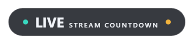

# Textbox Studio — OBS-Plugin

Text-Karten als OBS-Overlays (Browser-Sources) mit einem Dock-Panel direkt in OBS:
Karten erstellen, bearbeiten, importieren und live in die Szene senden. Reines C++/Qt-Plugin
(C++17, Qt-freier Core) — kein Server, keine externen Prozesse außer dem optionalen
AI-Sidecar (Python).

Aktuelle Version: **1.2.2** · [Releases](https://github.com/potato1345/OBS_Textbox/releases) · [Issues](https://github.com/potato1345/OBS_Textbox/issues)

## Vorlagen-Galerie

| Template | Beschreibung | Screenshot |
|----------|-------------|------------|
| **standard** | Drei Textzeilen mit farbigen Eck-Akzenten und Regenbogen-Modus |  |
| **badge** | Horizontale Pill-Badge mit Akzent-Punkten an den Enden |  |
| **board** | Platinenform: Leiterplatten-Panel mit Kupfer-Traces, Pads und Vias, die über die Card-Grenze nach außen führen |  |
| **display** | Große Zahl mit Akzent-Balken und Meta-Label |  |
| **minimal** | Drei Textzeilen mit 4px-Eck-Dots, transparenter Hintergrund |  |

Alle Vorlagen sind im Vorlagen-Ordner des Plugins (`Settings > Vorlagen-Ordner öffnen`) einsehbar und pro Karte im Feld **VORLAGE** auswählbar. Eigene `.html`-Vorlagen im Templates-Ordner werden sofort akzeptiert.

## Features

- **Karten**: dynamische Anzahl (im Zustand gespeichert), jede als eigene Browser-Source.
- **Vorlagen (Templates)**: `standard.html`, `display.html`, `minimal.html`, `badge.html`, `board.html` — jede nutzt `{{token}}`-Platzhalter.
- **Style-Properties pro Karte**: Schrift, Farbe/Transparenz, Box-Farbe, Corner-Farbe/-Opacity, CSS-Regeln, Animation, Regenbogen-Ecken.
- **Animationen**: relative Pfade, HTTP/HTTPS-URLs oder Data-URIs (mitgeliefert: `sparkle.webp`, `pulse.webp`).
- **Dock „Textbox Studio“**: Kartenliste, CSS-Regeln pro Karte, Schnell-Profile, Undo.
- **OBS-WebSocket**: externe Steuerung via `textbox_card_update` (JSON) und `textbox_clear` Events.
- **Persistence**: Einstellungen via OBS-Plugin-Settings; Karten-Zustand in `textbox-state.json`.

## Datenarchiv-Dialog (Import-Setup)

Toolbar-Icon ⤓ öffnet den Import-Dialog mit drei unabhängigen Wegen:

1. **Daten von URL (Google Forms / JSON)** — FORM-ID + OAuth-Token-Pfad; lädt JSON-Antworten und befüllt Karten.
2. **Datei-Import (CSV / XLSX / ZIP)** — `.xlsx`, `.csv`, `.txt` oder ZIP-Archive mit erwartetem Block-Format (Nr/Titel/Zeilen).
3. **AI-Import (PDF / DOCX)** — lokales Python mit `markitdown` extrahiert Text; optional OpenRouter-LLM analysiert und strukturiert als Karten.

### MarkItDown (Text-Import aus PDF/Word/Bildern)

Für den AI-Import wird **Python 3.10+** mit dem Paket `markitdown` benötigt. Installation:

```bash
python -m pip install markitdown
```

Das Plugin findet Python automatisch in folgender Reihenfolge:
- `py.exe` (Windows Python Launcher, System und Microsoft Store)
- `C:\Program Files\Python3xx\python.exe` (Python 3.14 bis 3.10, absteigend)
- `%LOCALAPPDATA%\Programs\Python\Python3xx\python.exe`
- `PATH`-Umgebungsvariable

Der Pfad kann manuell im **Gear-Menü → MARKITDOWN-PYTHON-PFAD** überschrieben werden, falls die Auto-Erkennung nicht greift.

**Fehlerbehebung:**  
- *"MarkItDown-Python nicht gefunden"* → kein Python-Interpreter gefunden oder `markitdown` nicht installiert. Die Meldung erscheint auch, wenn der Pfad im Gear-Menü gesetzt, aber ungültig ist.  
- *"markitdown fehlt im gefundenen Python"* → Python wurde gefunden, aber das Paket `markitdown` fehlt. Im selben Python `python -m pip install markitdown` ausführen.

## Unterstützte OBS-Versionen

| Platform | OBS Versionen | Build |
|----------|-------------|-------|
| Windows x64 | 28+, 32.2.2, 33.0.1 | Per CMake-Preset gegen obs-deps |
| macOS Universal | 28+, 32.2.2, 33.0.1 | Per CMake-Preset gegen obs-deps |
| Linux x86_64 | 28+, System-libobs-dev | Gegen Ubuntu `libobs-dev`-Paket |

Windows-Assets wurden real in OBS 32.2.2 und 33.0.1 getestet; macOS- und Linux-Assets sind CI-gebaut, aber nicht auf einer echten OBS-Installation getestet. Die `obs-frontend-api` ist seit OBS 28 ABI-stabil.

## Installation

1. **Runtime-Voraussetzungen** — die Plugin-DLL linkt die Visual-C++-Laufzeitbibliotheken dynamisch (`VCRUNTIME140.dll`, `VCRUNTIME140_1.dll`, `MSVCP140.dll`):
   - **Microsoft Visual C++ 2015–2022 Redistributable (x64)**: [vc_redist.x64.exe](https://aka.ms/vc14/vc_redist.x64.exe) — installiert alle drei DLLs systemweit.
   - **Windows 10/11 x64** (UCRT ist ab Win 10 enthalten).
   - **OBS ≥ 28 x64** mit Qt6 (`Qt6Core/Qt6Gui/Qt6Widgets.dll` in `bin\64bit`).

2. OBS komplett schließen.

3. Release-ZIP in das **OBS-Installations-Wurzelverzeichnis** entpacken. Der ZIP enthält `obs-plugins/` und `data/` — **beide Ordner müssen direkt neben `bin/`** im OBS-Installationsverzeichnis liegen (z. B. `C:\Program Files\obs-studio\`). Nicht in `%APPDATA%` und nicht nur in den `obs-plugins\`-Unterordner.

4. Alte Plugin-Version vollständig entfernen (alte DLL in `obs-plugins\64bit`, alter Datenordner unter `data\obs-plugins\`).

5. OBS starten. Nach einem Absturz kann OBS im abgesicherten Modus starten — dann werden Dritt-Plugins nicht geladen. Dialog mit „Im normalen Modus starten“ beantworten.

6. Log kontrollieren: `%APPDATA%\obs-studio\logs\<datum>.txt` muss `[textbox] Plugin erfolgreich geladen` zeigen.

### Selbstcheck

Das Repo enthält ein PowerShell-Skript zur Vorprüfung der Systemvoraussetzungen:

```powershell
.\plugin\.github\scripts\check-prereq.ps1
```

Es prüft VC-Redist, DLLs, Datenordner, Qt6 und das letzte Plugin-Log.

## Erste Schritte

- Dock "Textbox Studio" öffnen (erscheint automatisch oder über Menü Docks)
- Karten erstellen oder über das Import-Icon füllen (Google-Formular, CSV/XLSX, AI)
- Pro Karte Vorlage (VORLAGE) und Farbprofil setzen
- "Zu Szene" legt die Karte als Browser-Source in die aktuelle Szene
- Karten bleiben in `textbox-state.json` erhalten; Backup/Restore über das Gear-Menü

## Templates und Template-Tokens

Eigene HTML-Vorlagen werden im Vorlagen-Ordner (`Settings > Vorlagen-Ordner öffnen`) abgelegt. Folgende Token werden beim Schreiben substituiert:

| Token | Beschreibung |
|-------|-------------|
| `{{zeile1}}`, `{{zeile2}}`, `{{zeile3}}` | Textzeilen (bei clear=1 leer) |
| `{{zeile-N}}` (N=1..8) | Dynamische Zeilen-Werte |
| `{{zeile-count}}` | Anzahl aktiver Zeilen |
| `{{text_color}}` | Textfarbe als `rgba(...)` |
| `{{box_color}}` | Box-Hintergrundfarbe als `rgba(...)` |
| `{{corner_a}}`, `{{corner_b}}` | Eckfarben als `rgba(...)` |
| `{{corner_op_a}}`, `{{corner_op_b}}` | Eck-Transparenz (0..255) |
| `{{text_opacity}}` | Text-Transparenz (0..255) |
| `{{box_opacity}}` | Box-Transparenz (0..255) |
| `{{rainbow}}` | `"1"` oder `"0"` |
| `{{anim_src}}` | Animations-Pfad (Data-URI oder file://) |
| `{{show_anim}}` | `"1"` oder `"0"` |
| `{{anim_scale}}`, `{{anim_x}}`, `{{anim_y}}` | Animations-Skalierung/-Position |
| `{{box_x}}`, `{{box_y}}` | Box-Verschiebung (px, -1200..1200) |
| `{{box_scale}}` | Box-Skalierung (1,2,3,4,6,8,10,12) |
| `{{card_id}}` | Karten-ID (z. B. `box1`) |
| `{{clear}}` | `"1"` bei clear, sonst `"0"` |

## CSS-Variablen-Referenz

Über das CSS-Regel-Panel pro Karte (▼ GENERELLE CSS-REGELN) können folgende Variablen gesetzt werden:

### Layout
- `--tb-radius` — Rahmenradius der Box (px)
- `--tb-padding`, `--tb-padding-top`, `--tb-padding-left` — Innenabstand
- `--tb-gap` — Abstand zwischen Zeilen
- `--tb-min-width`, `--tb-max-width` — Box-Breite
- `--tb-text-align` — Textausrichtung
- `--tb-font-family`, `--tb-font-first`, `--tb-font-first-weight` — Schrift (erste Zeile)
- `--tb-font-rest`, `--tb-font-rest-weight` — Schrift (restliche Zeilen)
- `--tb-corner-size` — Größe der Ecken-Dreiecke

### Farbe/Transparenz
- `--tb-color-text`, `--tb-color-box` — Text-/Box-Farbe
- `--tb-corner-color-a`, `--tb-corner-color-b` — Eckfarben
- `--tb-corner-opacity-a`, `--tb-corner-opacity-b` — Eck-Transparenz
- `--tb-text-opacity`, `--tb-box-opacity` — Text-/Box-Transparenz
- `--tb-rainbow` — Regenbogen-Ecken (0/1)

### Animation
- `--anim-show`, `--show-anim` — Animation ein/aus (0/1)
- `--anim-file` — Animations-Dateipfad
- `--anim-scale` — Animations-Skalierung (1,2,3,4,6,8,10,12)
- `--anim-x`, `--anim-y` — Animations-Verschiebung (px, -1200..1200)

### Box-Position/Skalierung
- `--box-x`, `--box-y` — Box-Verschiebung (px, -1200..1200)
- `--box-scale` — Box-Skalierung (1,2,3,4,6,8,10,12)

## Gear-Einstellungen

Das Zahnrad-Menü (⚙) bietet:

- **Schnell-Profile** — komplette Karten-Konfiguration speichern/wiederherstellen
- **Einstellungen** — Google-Form-ID, OAuth-Token-Pfad, OpenRouter-API-Key, MarkItDown-Python-Pfad, Animations-Verzeichnis, Referenztabelle, Textbox-Pfad, AI-System-Prompt
- **Vorlagen-Ordner öffnen** — öffnet den user-Templates-Ordner im Datei-Explorer
- **Vorlage aus classic kopieren** — kopiert `index.html` als `classic.html` in den Templates-Ordner
- **Backup erstellen/wiederherstellen** — exportiert/importiert den aktuellen Karten-Zustand

## Bau

```bash
cd plugin
cmake --preset windows-x64        # Linux: ubuntu-x86_64 / macOS: macos
cmake --build build_x64 --config RelWithDebInfo
```

### Tests

```bash
ctest --test-dir build_x64 -C RelWithDebInfo
```

Die Test-Suiten decken den Qt-freien Core ab: State, HTML-Rendering, Tabellen-Import, AI-Import (Stub-LLM) und Qt6-Render-Tests.

### Deploy nach OBS Studio

```bash
cmake --install build_x64 --config RelWithDebInfo --prefix "C:/Program Files/obs-studio"
```

Das `--prefix` muss auf das OBS-Installationsverzeichnis zeigen. Der Befehl kopiert `index.html`, Vorlagen und Animationen in das Plugin-Data-Verzeichnis.

## Struktur

```
plugin/                     OBS-Plugin (Quellcode, CMake, Data, Tests)
plugin/src/                 Quellen (Dock, Overlay, HTML, Import, AI)
plugin/src/tests/           Test-Suiten + samples
plugin/templates/           Overlay-Vorlagen (standard/display/minimal/badge/board)
plugin/data/                Plugin-Data (index.html, Animationen, Locale)
plugin/.github/scripts/     Hilfsskripte (check-prereq.ps1)
docs/DESIGN.md              UI-Design-Spec (Spacing-Raster, Theme-Tokens)
docs/native-style-notes.md  Referenz: natives OBS-Plugin-Styling
```

## Fehlerbehebung

### Plugin wird nicht geladen

- Log prüfen: `%APPDATA%\obs-studio\logs\<datum>.txt` — nach `[textbox]` suchen.
- Fehlt `[textbox] Plugin erfolgreich geladen` → VC-Redist nicht installiert oder DLL fehlt.
- OBS im abgesicherten Modus? → Dialog „Im normalen Modus starten".
- Alte Plugin-DLL im `obs-plugins\64bit`? → Nur eine Version darf existieren.

### Browser-Sources funktionieren nicht

- Sicherstellen, dass `events_listen` in den Browser-Quellen aktiviert ist (das Plugin setzt es automatisch).
- Bei schwarzen Boxen: `shutdown`-Setting darf nicht gesetzt sein.
- Live-Push benötigt den `javascript_event`-Proc-Handler der Browser-Source.

### OBS lässt sich nicht schließen (Close-Hang)

- Wenn das Plugin geladen ist, aber Browser-Sources in Szenen verbleiben, kann CEF den Shutdown blockieren.
- Ab Version 1.2.2 registriert das Plugin einen Shutdown-Event-Callback, der alle Karten-Sources vor dem Herunterfahren entfernt.
- Workaround: Alle Karten manuell löschen oder Szenen ohne Textbox-Sources wechseln, bevor OBS geschlossen wird.

## Lizenz

MIT — siehe `plugin/LICENSE`.