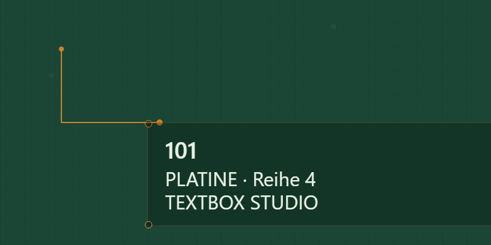
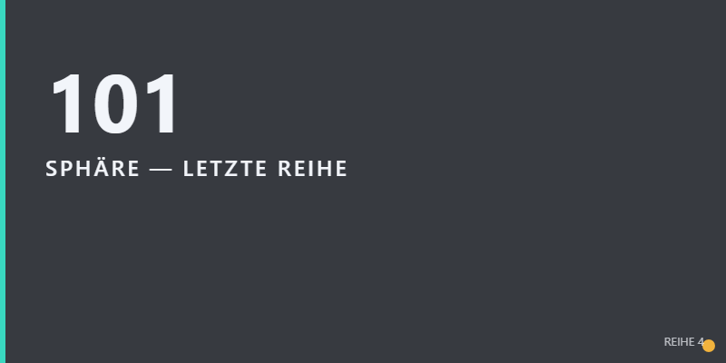
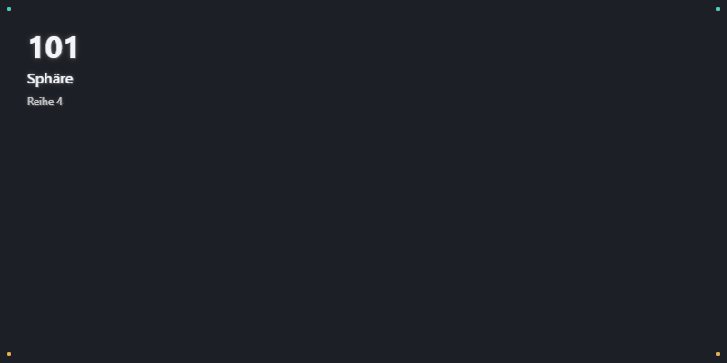

# Textbox Studio — OBS-Plugin

Text-Karten als OBS-Overlays (Browser-Sources) mit einem Dock-Panel direkt in OBS:
Karten erstellen, bearbeiten, importieren und live ins Scene senden. Reines C++/Qt-Plugin
(C++17, Qt-freier Core) — kein Server, keine externen Prozesse außer dem optionalen
AI-Sidecar (Python).

Aktuelle Version: **1.2.1** · [Releases](https://github.com/potato1345/OBS_Textbox/releases) · [Issues](https://github.com/potato1345/OBS_Textbox/issues)

## Vorlagen-Galerie

| Template | Description | Screenshot |
|----------|-------------|------------|
| **standard** | Drei Textzeilen mit farbigen Eck-Akzenten und Regenbogen-Modus |  |
| **badge** | Horizontale Pill-Badge mit Akzent-Punkten an den Enden |  |
| **board** | Platinenform: Leiterplatten-Panel mit Kupfer-Traces, Pads und Vias, die über die Card-Grenze nach außen führen |  |
| **display** | Große Zahl mit Akzent-Balken und Meta-Label |  |
| **minimal** | Drei Textzeilen mit 4px-Eck-Dots, transparenter Hintergrund (hier auf dunklem Yami gezeigt) |  |

Alle Vorlagen sind im Vorlagen-Ordner des Plugins (`Settings > Vorlagen-Ordner öffnen`) einsehbar und pro Karte im Feld **VORLAGE** auswählbar. Eigene `.html`-Vorlagen im Templates-Ordner werden sofort akzeptiert.

## Features

- **Karten**: dynamische Anzahl (im Zustand gespeichert, z. B. 12), jede als eigene Browser-Source.
- **Vorlagen (Templates)**: `standard.html`, `display.html`, `minimal.html`, `badge.html`, `board.html` — jede nutzt `{{token}}`-Platzhalter (`zeile1..3`, `box_color`, `text_color`, …).
- **16 Style-Properties pro Karte**: Schrift, Farbe/Transparenz, Box-Farbe, Corner-Farbe/-Opacity, Animation, Regenbogen-Ecken.
- **Animationen**: relative Pfade, HTTP/HTTPS-URLs oder Data-URIs (mitgeliefert: `sparkle.webp`, `pulse.webp`).
- **Dock „Textbox Studio“**: Kartenliste, CSS-Regeln pro Karte, Schnell-Profile, Live-Vorschau, Undo.
- **OBS-WebSocket**: externe Steuerung via `textbox_card_update` (JSON) und `textbox_clear` Events.
- **Persistence**: Einstellungen via OBS-Plugin-Settings; Karten-Zustand in `textbox-state.json`.

## Datenarchiv-Dialog (Import-Setup)

Toolbar-Icon ⤓ öffnet den Import-Dialog mit drei unabhängigen Wegen:

1. **Daten von URL (Google Forms / JSON)** — FORM-ID + OAuth-Token-Pfad; lädt JSON-Antworten und befüllt Karten.
2. **Datei-Import (CSV / XLSX / ZIP)** — `.xlsx`, `.csv`, `.txt` oder ZIP-Archive mit erwartetem Block-Format (Nr/Titel/Zeilen).
3. **AI-Import (PDF / DOCX)** — lokales Python mit `markitdown` extrahiert Text; optional OpenRouter-LLM analysiert und strukturiert als Karten.

### MarkItDown (Text-Import aus PDF/Word/Bildern)

Für den AI-Import wird **Python 3.10+** mit dem Paket `markitdown` benötigt. Installation:

```bash
winget install Python.Python.3.12
python -m pip install markitdown
```

Das Plugin findet Python automatisch in folgender Reihenfolge:
- `py.exe` (Windows Python Launcher, System und Microsoft Store)
- `C:\Program Files\Python3xx\python.exe` (Python 3.14 bis 3.10, absteigend)
- `%LOCALAPPDATA%\Programs\Python\Python3xx\python.exe`
- `PATH`-Umgebungsvariable

Der Pfad kann manuell im **Gear-Menü → MARKITDOWN-PYTHON-PFAD** überschrieben werden, falls die Auto-Erkennung nicht greift.

**Fehlerbehebung:**  
- *"MarkItDown-Python nicht gefunden"* → kein Python-Interpreter gefunden oder `markitdown` nicht installiert. Die Meldung erscheint auch, wenn der Pfad im Gear-Menü gesetzt, aber ungültig ist.  
- *"markitdown fehlt im gefundenen Python"* → Python wurde gefunden, aber das Paket `markitdown` fehlt. Im selben Python `python -m pip install markitdown` ausführen.

## OBS-Kompatibilität

**Live-getestet (Real-World-Installation und Betrieb, Windows x64):**
- **OBS 33.0.1** — vollständiger Live-Test: Plugin lädt, Dock „Textbox Studio“, Karten, Preview, Szenen-Integration
- **OBS 32.2.2** — Live-Test am 22.11.2026 mit portable OBS 32.2.2: Release-ZIP ins Installations-Wurzelverzeichnis entpackt, Plugin lädt (Log „Plugin erfolgreich geladen“), Dock registriert, Karten aus textbox-state.json geladen, Preview korrekt

**Nicht live-getestet (nur in GitHub Actions gebaut):**
- macOS Universal und Linux x86_64 — die CI baut diese Assets, aber kein Real-World-Test in einer echten OBS-Installation auf diesen Plattformen wurde durchgeführt.

**Kompatibel erwartet (nicht getestet):** OBS ≥ 28 (stabile Plugin-ABI via `obs-frontend-api`); OBS 32.2.3 (Patch-Release mit identischer ABI zur 32.2.2).

## Erster Live-Betrieb (Checkliste)

- Release-ZIP der passenden OBS-Version installieren und OBS neu starten
- Dock "Textbox Studio" über Menü Docks öffnen
- Karten erstellen oder über das Import-Icon füllen (Google-Formular, CSV/XLSX, AI)
- Pro Karte Vorlage (VORLAGE) und Farbprofil setzen
- "Zu Szene" legt die Karte als Browser-Source ins aktuelle Scene; Source-Position bei Bedarf im Scene-Editor anpassen
- Karten bleiben in textbox-state.json erhalten; Backup/Restore über das Gear-Menü

## Installation auf einem Prod-PC (Windows)

0. **Runtime-Voraussetzungen einmalig installieren** — die Plugin-DLL linkt die Visual-C++-Laufzeitbibliotheken dynamisch (`VCRUNTIME140.dll`, `VCRUNTIME140_1.dll`, `MSVCP140.dll`). Diese liegen **nicht** im ZIP und **nicht** im OBS-Ordner — ohne sie bricht OBS beim Plugin-Laden still ab:
   - **Microsoft Visual C++ 2015–2022 Redistributable (x64)**: https://aka.ms/vc14/vc_redist.x64.exe — installiert alle drei DLLs systemweit.
   - **Windows 10/11 x64** (UCRT `api-ms-win-crt-*` ist ab Win 10 dabei; Win 7/8 brauchen das UCRT-KB).
   - **OBS 32.2.2 oder 33.0.1 x64** mit Qt6 (`Qt6Core/Qt6Gui/Qt6Widgets.dll` in `bin\64bit`) — das stellt OBS selbst.
   - Selbstcheck ohne OBS: `plugin\.github\scripts\check-prereq.ps1` (im Repo) ausführen (prüft VC-Redist, DLL, Datenordner, Qt6, letztes Plugin-Log).
1. OBS komplett schließen (nicht nur das Fenster — es darf kein `obs64.exe` mehr laufen).
2. Installationsort des OBS herausfinden (Short-Ziel, z. B. `C:\Program Files\obs-studio\` oder Steam-Ordner). Der ZIP enthält `obs-plugins\` und `data\` — **beide Ordner müssen in das Installations-Wurzelverzeichnis** des OBS entpackt (direkt neben `bin\`), nicht in `%APPDATA%` und nicht nur in `obs-plugins\`.
3. Altes Plugin komplett entfernen (alte DLL im `obs-plugins\64bit`, alter Datenordner unter `data\obs-plugins\`, altes Dock „Textbox control“ im Menü Docks abwählen) — sonst konkurrieren zwei Plugin-Versionen.
4. OBS starten. Nach einem Absturz kann OBS im **abgesicherten Modus** starten — dann werden Dritt-Plugins nicht geladen und das Dock erscheint nicht. Dialog mit „Im normalen Modus starten“ beantworten.
5. Log kontrollieren: `%APPDATA%\obs-studio\logs\<datum>.txt` muss `[textbox] Plugin erfolgreich geladen` und „Dock registriert … Erfolg=ja“ zeigen.

| Platform | OBS Versions | Build |
|----------|-------------|-------|
| Windows x64 | 32.2.2, 33.0.1 | Per CMake-Preset gegen obs-deps |
| macOS Universal | 32.2.2, 33.0.1 | Per CMake-Preset gegen obs-deps |
| Linux x86_64 | System-libobs-dev | Gegen Ubuntu `libobs-dev`-Paket |

Download-ZIPs folgen dem Schema `textbox-studio-<ver>-obs-<OBSVER>-<platform>.zip`.
Die Tabelle ist die CI-Build-Matrix — **nur die Windows-Assets wurden real in OBS getestet** (32.2.2 und 33.0.1); macOS- und Linux-Assets sind CI-gebaut, aber ungetestet.
Die `obs-frontend-api` ist seit OBS 28 ABI-stabil. Für andere OBS-Versionen: Abhängigkeiten neu ziehen (CMake lädt die passende Version) und neu bauen.

## Bau

```bash
cd plugin
cmake --preset windows-x64        # Linux: ubuntu-x86_64 / macOS: macos
cmake --build build_x64 --config RelWithDebInfo
```

### Tests

```bash
ctest --test-dir build_x64 -C RelWithDebInfo
```

8 Test-Suiten decken den Qt-freien Core ab: Controls, HTML-Rendering, Tabellen-Import, AI-Import (Stub-LLM) und Qt6-Render-Test.

### Deploy nach OBS Studio

DLL + PDB nach `<OBS>\obs-plugins\64bit\` und `<OBS>\bin\64bit\` kopieren;
Plugin-Data unter `<OBS>\data\obs-plugins\textbox-studio\` per `cmake --install`:

```bash
cmake --install build_x64 --config RelWithDebInfo --prefix "C:/Program Files/obs-studio"
```

Das `--prefix` muss auf das OBS-Installationsverzeichnis zeigen (alternativ `<OBS>`).
Der Befehl kopiert `index.html`, Vorlagen und Animationen in das Plugin-Data-Verzeichnis.

## Nutzung

1. OBS starten — das Dock „Textbox Studio“ erscheint automatisch.
2. Kartendaten eingeben — die Vorschau aktualisiert live.
3. „Zu Szene“ legt die Browser-Source automatisch an (alternativ manuell: Browser-Source mit der Overlay-HTML, mind. 1200×600 px).
4. Externe Steuerung: OBS-WebSocket mit `textbox_card_update`-Events.

## Release

GitHub Actions baut bei **Tag-Push** `v*` für Windows/macOS/Linux und veröffentlicht als GitHub-Release.

```bash
git tag -f vX.Y.Z <commit> && git push -f origin vX.Y.Z
```

## Struktur

```
plugin/                     OBS-Plugin (Quellcode, CMake, Data, Tests)
plugin/src/                 Quellen (Controls, Dock, Overlay, HTML, Import, AI, Theme)
plugin/src/tests/           Qt-freie Test-Suiten + samples
plugin/templates/           Overlay-Vorlagen (standard/display/minimal/badge/board)
docs/DESIGN.md              UI-Design-Spec (Spacing-Raster, Theme-Tokens)
docs/native-style-notes.md  Referenz: natives OBS-Plugin-Styling
tools/ui_spacing_check.py   UI-Audit-Tool (Pixel-Gaps gegen DESIGN.md)
assets/screenshots/         Vorlagen-Galerie-Bilder
```

## Lizenz

MIT — siehe `plugin/LICENSE`.
