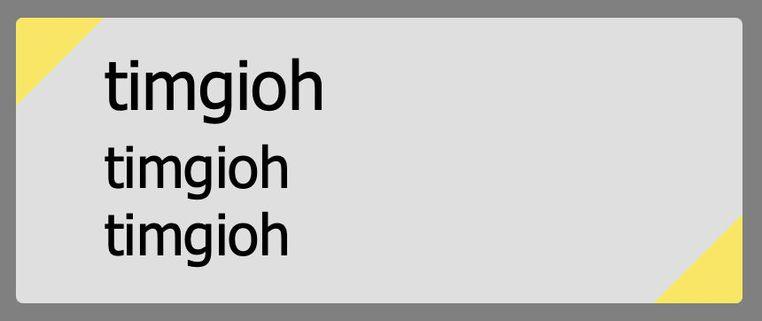

# OBS_Textbox

OBS browser view text field that can be customized via the "Custom CSS" tab — with external live control through a web dashboard or a native OBS Studio plugin.

## Ordner-Layout (drei Versionen, komplett separiert)

| Ordner | Version | Inhalt |
|--------|---------|--------|
| `main/` | **v1** | Original: `server.py` (Port 8080), `controlui/` Dashboard, `textbox.html` Overlay, Liedplan-Quellen, Tests |
| `rewrite/` | **v2** | Neuschreibung: `server/` (http_app, forms_import, documents), `dashboard/` (ES-Modules), `tests/` (Python + JS) |
| `plugin/` | **v3** | Native OBS-Plugin (Qt6/CMake, M0–M7h + IMP-A–E, ctest 7/7) — eigenständiges obs-plugintemplate-Projekt |

Root enthält nur Projekt-Doku (`README.md`, `FUNKTIONSVERGLEICH.md`, `CODE_TODO.md`) und das floorplan-Tooling. Secrets (`*.env`, api.env, tokens) sind überall durch `.gitignore` ausgeschlossen.

## Build- & Start-Anleitung für v3 (`plugin/`) und v2 (`rewrite/`)

### v3 — Natives OBS-Studio-Plugin (`plugin/`)
Kein lokaler Python-Server und kein OBS-WebSocket nötig (läuft direkt in-process als natives Qt6-Dock in OBS Studio 32.x):

1. **Konfigurieren & Bauen** (Arbeitsverzeichnis `plugin/`, wo `CMakePresets.json` liegt):
   ```powershell
   cd plugin
   cmake --preset windows-x64
   cmake --build --preset windows-x64 --config RelWithDebInfo
   ```
2. **Unit-Tests ausführen** (7 CTest-Suiten):
   ```powershell
   ctest --test-dir build_x64 -C RelWithDebInfo
   ```
3. **Installation / Deploy nach OBS Studio**:
   - Gebaute DLL `plugin/build_x64/RelWithDebInfo/liedplan-for-obs.dll` nach `<OBS Studio>\obs-plugins\64bit\liedplan-for-obs.dll` kopieren.
   - Optional für andere PCs (ohne lokales Repo): `main/textbox.html` und `main/controlui/lieder.md` werden über `cmake --install` in das Plugin-Data-Verzeichnis (`<OBS Studio>\data\obs-plugins\liedplan-for-obs\`) installiert und zur Laufzeit über `obs_module_file()` aufgelöst (Reihenfolge: Settings-Override → `obs_module_file()` → Dev-Fallback).

### v2 — Modulare Web-Neuschreibung (`rewrite/`)
1. **Server starten**: `rewrite/start_server.bat` (Windows) bzw. `./rewrite/start_server.sh` (Linux/macOS) ausführen (oder `python -m rewrite.server`).
2. **Dashboard in OBS einbinden**: Unter **Docks -> Custom Browser Docks...** die URL `http://127.0.0.1:8080/dashboard/` eintragen.
3. **Tests ausführen**:
   - Python: `.venv\Scripts\python.exe -m unittest discover rewrite/tests`
   - JS: `node tests/test_js_modules.js` (aus `rewrite/`)

## Preview



## How It Works (v1 — `main/`)

| File | Purpose |
|------|---------|
| `main/textbox.html` | The OBS Browser Source overlay — shows text from CSS variables |
| `main/controlui/control.html` | A browser dashboard (OBS Custom Dock) to control multiple textboxes simultaneously |
| `main/start_server.bat` / `.sh` | Lightweight local web server scripts to run the dashboard |

The dashboard talks to OBS over the **OBS WebSocket server** (built into OBS 28+). Each time you type in a card, the dashboard rewrites the *Custom CSS* of the matching browser source — text and colors update live. All state is saved in the browser's local storage and survives OBS restarts; if the connection drops, the dashboard reconnects automatically.

While the core text system works offline and serverless, using advanced features like **AI PDF Import** requires the dashboard to be served via the local web server (`start_server` scripts) because the OBS browser strictly blocks external API requests from local `file:///` paths.

## Setup (v1 — `main/`)

### 1. Enable the OBS WebSocket Server

1. In OBS, go to **Tools -> WebSocket Server Settings**.
2. Check **Enable WebSocket server** and optionally set a **Password**.
3. Click OK and (if asked) restart OBS.

### 2. Start the Local Server & Add Dashboard to OBS

*To ensure all features (including the AI PDF Import) work without browser security errors, you should run the dashboard via the local web server.*

1. Run the included start script for your OS (requires Python):
   - **Windows:** Double-click `main/start_server.bat`
   - **Mac/Linux:** Open terminal and run `./main/start_server.sh`
   *(This starts a local background server on port 8080. Leave the black console window open while streaming).*
2. In OBS, go to **Docks** -> **Custom Browser Docks...**
3. Name the dock (e.g., "Textbox Control").
4. For the URL, enter exactly: `http://localhost:8080/controlui/control.html` (vom Ordner `main/` aus gestartet)
5. Apply and place the dock anywhere in your OBS UI.
6. Open **Einstellungen** in the dashboard, enter the WebSocket password and click **Mit OBS verbinden** (auto-reconnect is on by default).

> **Offline Mode (No AI PDF Import):** If you don't need the AI PDF features, you can skip starting the server and just enter the local file path directly as the URL (e.g. `file:///C:/Path/To/OBS_Textbox/main/controlui/control.html`).
>
> **Netzwerk-Bindung & Sicherheit (`OBS_TEXTBOX_BIND` in `main/server.py`):** Standardmäßig bindet `main/server.py` nur lokal auf Loopback (`127.0.0.1:8080`) und beschränkt `Access-Control-Allow-Origin` auf Loopback/Localhost-Origins. Zugriffe auf Punkt-Dateien (`/.…`), `.py`-Skripte und `api.env` werden von jeder IP mit `404` abgewiesen. Für den bewussten Opt-in-Zugriff im Kirchen-WLAN (z. B. vom Smartphone) kann die Umgebungsvariable `OBS_TEXTBOX_BIND=0.0.0.0` gesetzt werden (aktiviert LAN-Bindung und `Access-Control-Allow-Origin: *`).

### 3. Add the Textbox to OBS

1. Add a new **Browser Source** in OBS.
2. Check the **"Local file"** box and select the `main/textbox.html` file.
3. Set the dimensions to at least **Width: 1200, Height: 600** (the overlay uses large padding to leave room for animations above the box — smaller values may push the textbox out of the visible area).
4. Scroll down to the **"Custom CSS"** field.
5. Define your `--box-id` exactly like this:

```css
:root {
    --box-id: "lowerthird";
}

body { background-color: rgba(0, 0, 0, 0); margin: 0px auto; overflow: hidden; }
```

### 4. Open the Control Dashboard

1. Use the dock you added in step 2.
2. You'll see a card for each textbox you want to control.
3. Set each card's **ID** to match the `--box-id` configured in OBS (e.g., `lowerthird`).
4. Type your text and the OBS overlay updates instantly — with **Auto-Send** (default) each change is pushed automatically, or use **Senden** / **Alle senden** per card.

## Profiles & Saving

- The dashboard automatically saves your inputs, custom profiles, and active cards directly in the local storage of OBS. Everything is restored even after a PC restart or OBS relaunch.
- **Schnell-Profile**: save the full state of all boxes under a name (top-right chips) and reload it with one click.
- **Farbprofile**: the settings dialog contains default dashboard color profiles (plus YAML import/export and your own profiles) — independent of the textbox content.
- **Export / Import** (JSON) moves the complete state between machines.

## Advanced CSS Customization

You can fully customize the look directly in OBS via the **"Custom CSS"** field. Just add these variables inside the `:root` block:

| Variable | Description | Default |
|----------|-------------|---------|
| `--box-bg` | Background color of the box | `rgba(255, 255, 255, 0.75)` |
| `--box-border` | Border color | `rgba(0, 0, 0, 0.7)` |
| `--triangle-color-a` | Top-left corner accent | `#fce647` |
| `--triangle-color-b` | Bottom-right corner accent | `#fce647` |
| `--text-color` | Text color | `#000000` |
| `--zeile-1` | Text line 1 (can also be set statically here) | `""` |
| `--zeile-2` | Text line 2 (can also be set statically here) | `""` |
| `--zeile-3` | Text line 3 (can also be set statically here) | `""` |

Notes:

- The dashboard also manages `--box-opacity` via WebSocket: an empty box (all three lines cleared) fades out automatically.
- Empty text lines are hidden automatically, so the box shrinks to the visible content.

Example of a fully customized box in OBS:
```css
:root {
    --box-id: "interview";
    --box-bg: rgba(20, 20, 20, 0.9);
    --text-color: #ffffff;
    --triangle-color-a: #ff0055;
    --triangle-color-b: #ff0055;
}

body { background-color: rgba(0, 0, 0, 0); margin: 0px auto; overflow: hidden; }
```

## Troubleshooting

- **"Verbindung fehlgeschlagen"** — check that the WebSocket server is enabled, OBS is running, and the password in the dashboard matches (`Tools -> WebSocket Server Settings`).
- **Nothing updates in OBS** — make sure the browser source's Custom CSS contains `--box-id: "…"` (with quotes) and that the card ID in the dashboard matches exactly.
- **Black or invisible textbox** — the overlay needs at least **1200×600 px** in the browser source properties. The HTML uses large internal padding (`padding-top: 350px`) to leave room for animations; a smaller source pushes the box out of the visible area.
- **OBS restarts** — the dashboard reconnects automatically after ~3 seconds and re-applies all boxes.
