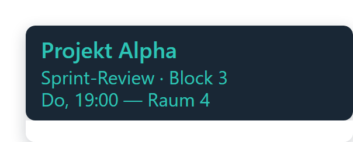

# Textbox Studio — OBS-Plugin

Erstellen und Verwalten vieler Textbox-Browserquellen in OBS: bis zu **8 Textbox-Overlays**
mit drei unabhängig positionierten Textzeilen pro Karte, Animations-GIF, Regenbogen-Ecken
und einem Dock-Panel mit Live-Vorschau direkt im OBS-Programmfenster.

Das Plugin ist ein reines OBS-Plugin (C++17, Qt-freier Core): kein Server, kein
Browser, keine externen Prozesse. Alle Texte, Farben, Layouts und Animationen
werden über die Plugin-eigene UI gesetzt oder über OBS-WebSocket von externen
Tools gesteuert.

## Screenshots

Karte mit dem Standard-Template, gerendert als Browser-Source außerhalb von OBS:



## Features

- **8 Karten** (`box1`–`box8`), jede als eigenes OBS-Overlay (Browser-Source)
- **Templates**: eine mitgelieferte Vorlage (`standard.html`) im
  Vorlagen-Ordner des Plugin-Data-Verzeichnisses; eigene Vorlagen als `.html`
  per Pfad-Eingabe oder Picker
- **3 Textzeilen** pro Karte, unabhängig positioniert und sized
  (`zeile1/2/3` mit je `x`, `y`, `w`, `h`, `fsize`)
- **16 Style-Properties** pro Karte: Schrift (`Arial`, `Comic Sans MS`,
  `Courier`), Farbe und Transparenz je Zeile, Box-Farbe/-Transparenz (0–100),
  Corner-Farbe und -Opacity, Animations-Size und Regenbogen-Ecken
- **Animations**: relative Pfade, HTTP/HTTPS-URLs oder Data-URIs
  (Data-URIs werden als temporäre Datei materialisiert); mit dem Plugin
  geshiped: `data/animations/` (`sparkle.webp`, `pulse.webp` — transparent,
  loopend). Relative Namen werden im eigenen Animations-Ordner und im
  mitgelieferten Ordner gesucht
- **Live-Dock**: Karten-Tabs mit allen Feldern, Live-Vorschau der aktuellen
  Karte (QWebEngineView), Undo/Redo mit Undo-History
- **Import aus Tabellen**: `.xlsx`, `.csv`, `.txt` (UTF-8 oder UTF-16LE mit BOM,
  Excel-Semicolon-Trennung) über den Import-Dialog; erwartet 12 Blöcke mit den
  Spalten `Block N – Nr`, `Block N – Titel`, `Block N – Zeilen`
- **Import aus einer URL**: JSON-Antworten von einer Formular-/Tabellen-URL laden
  (OAuth-Token wird unterstützt)
- **AI-Import**: PDF/DOCX via lokalem markitdown-Sidecar (Python) und
  OpenRouter-LLM (`OPENROUTER_API_KEY` in der konfigurierten Key-Datei);
  ohne Key/Python bleibt der Button ohne Effekt. Optional kann eine
  Referenztabelle Nummern zu Titeln ergänzen
- **OBS-WebSocket**: Steuerung von außen über die Events `textbox_card_update`
  (JSON mit allen Feldern einer Karte) und `textbox_clear`
- **Persistence**: alle Einstellungen über OBS-Plugin-Settings; Karten-HTML und
  Templates werden mit dem Plugin installiert und zur Laufzeit injiziert

## Bau

Voraussetzungen: CMake ≥ 3.16, Git; OBS Studio und Abhängigkeiten werden beim
ersten Configure automatisch nach `plugin/.deps/` heruntergeladen.

```bash
cd plugin
cmake --preset windows-x64        # Linux: ubuntu-x86_64 / macOS: macos
cmake --build build_x64 --config RelWithDebInfo
```

Das DLL liegt danach in `build_x64/RelWithDebInfo/` bzw. unter
`build_x64/obs-studio/bin/64bit/`.

### Tests

```bash
ctest --test-dir build_x64 -C RelWithDebInfo
```

8 Test-Suiten decken die Qt-freie Core ab: Controls (Normalization und
Boundary-Guards), HTML-Rendering (CSS-Injektion, Padding-Schutz, JSON-Shape),
Tabellen-Import (Fixtures in `plugin/src/tests/samples/`), AI-Import
(Stub-LLM ohne Netzwerk) und der Qt6-Render-Test (echtes QWebEngine-Rendering
mit Layout-Bounds).

### Deploy nach OBS Studio

Manuell: DLL nach `<OBS Studio>\obs-plugins\64bit\` kopieren; das
Plugin-Data-Verzeichnis `<OBS Studio>\data\obs-plugins\textbox-studio\`
enthält `index.html`, `templates/` und `locale/` (über
`cmake --install build_x64`).

## Nutzung

1. OBS starten, das Dock **„Textbox Studio"** öffnen.
2. Tab für die gewünschte Karte (`box1`–`box8`) wählen, Felder setzen — die
   Vorschau aktualisiert live.
3. Overlay: das Plugin legt die Browser-Source automatisch an; alternativ eine
   bestehende Browser-Source mit der Overlay-HTML verwenden (mind. 1200×600 px).
4. Externe Steuerung: OBS-WebSocket mit `textbox_card_update`-Events.

## Release

GitHub Actions baut bei Tags `v*` die Plugins für Windows (x64), macOS
(Universal) und Linux (x86_64) und veröffentlicht sie als GitHub-Release mit
drei ZIP-Assets (`.github/workflows/build.yml`). Manuelle Releases: Build wie
oben, dann DLL/`.dylib`/`.so` + `data/` + `templates/` + `locale/` als
`textbox-studio-<version>-<plattform>.zip` hochladen.

## Struktur

```
plugin/                OBS-Plugin (Quellcode, CMake, Data, Tests)
plugin/src/            Quellen (Controls, Dock, Overlay, HTML, Import, AI)
plugin/src/tests/      Qt-freie Test-Suiten + samples
plugin/templates/      Overlay-Templates (standard/display/minimal)
assets/screenshots/    README-Screenshots (Browser-Source-Renders)
```

## Lizenz

MIT — siehe `plugin/LICENSE`.
